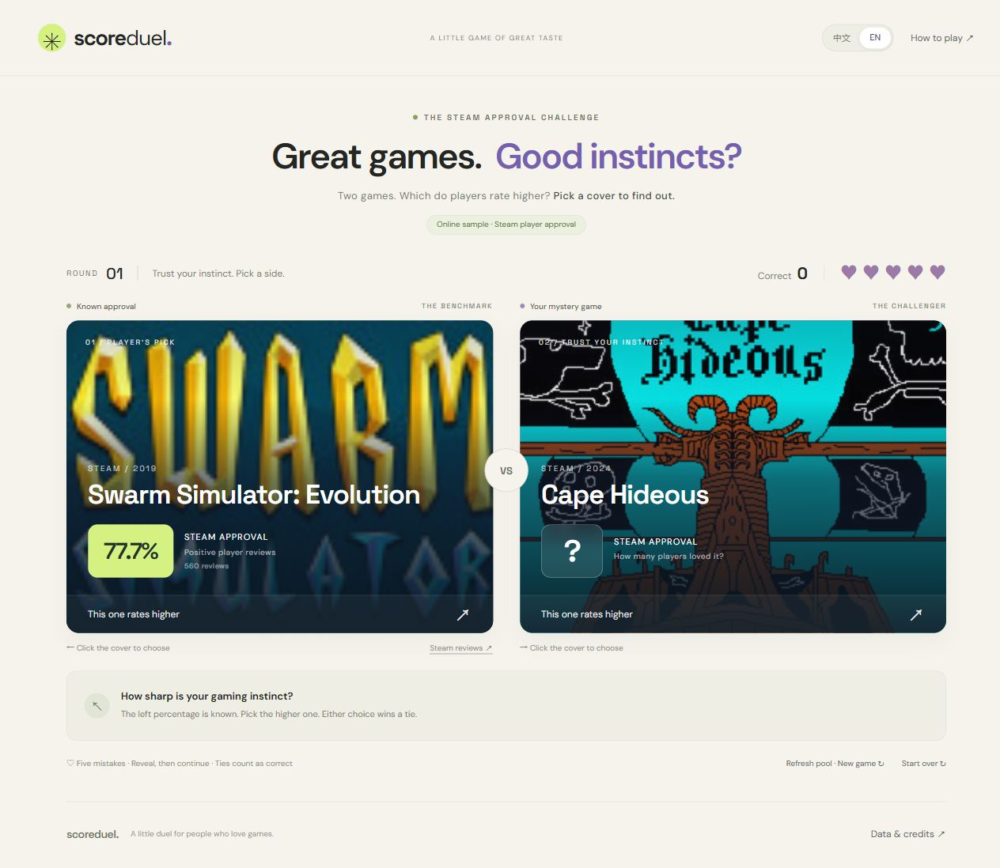

# Score Duel



## Idea

Score Duel is a guessing game about Steam player reviews. Which of two games has the higher percentage of positive reviews? Each answer reveals the real percentages, turning the player's expectations into immediate feedback.

## Intended User

The experience is designed for video game fans and anyone curious about how other players rate games. No Steam account or specialist knowledge is required.

## Main Interaction

1. Two game covers and names appear side by side. The left game's approval percentage is visible; the right game's is hidden.
2. Click the cover you think has the higher approval percentage, or press the left or right arrow key.
3. Both percentages and review counts are revealed, together with feedback showing whether your guess was correct. Percentages are compared to one decimal place; either choice is correct in a tie.
4. Click **Next round** or press **Enter**. The previous right game moves to the left, and a new game appears on the right.
5. After five mistakes, the game shows your total correct answers, completed rounds and accuracy. Choose **Play again** to start another run.

The language controls switch between Chinese and English without losing progress. Starting over resets the score but keeps the draw history until the page is reloaded. Repeated clicks after an answer do not award extra points.

## How to Run

Install [Node.js 20 or newer](https://nodejs.org/). No third-party packages or API keys are required.

**Windows shortcut:** double-click `start-local.cmd` in the project folder. It starts the server and opens the default browser.

Alternatively, open a terminal in the project folder and run:

```sh
node scripts/serve.mjs --open
```

Open [http://127.0.0.1:4173/](http://127.0.0.1:4173/) if the browser does not open automatically. Keep the server window open while playing; press **Ctrl+C** to stop it. If a server is already running, keep its original window open. Stop and restart it after backend changes. Do not open `dist/index.html` directly.

## Known Limitations

- Games must have **more than 500 matching reviews**. Approval is calculated from positive reviews divided by total reviews, using all languages, Steam purchases and off-topic filtering. Different Steam store filters may show different results.
- Online sampling uses Steam's visible store catalogue and official review statistics. It does not cover the entire Steam library or guarantee uniform randomness. Store search may change or become unavailable.
- Review statistics are cached for 10 minutes. If online requests fail, the game uses saved data and a bundled snapshot of 50 real games. The interface labels the source; saved percentages may be outdated.
- The available pool is finite. Drawn games are excluded across rounds and replays, but the pool is reshuffled if no unseen games can be obtained. Reloading the page clears both progress and draw history; only the language preference is saved.
- Online sampling requires the Node server. Static hosting supports the snapshot fallback only. Covers need network access; missing images fall back to a gradient and the game name.
